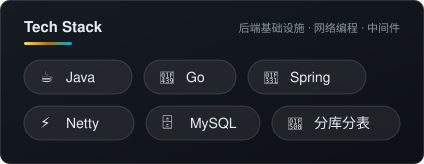

## Hi, I'm isPengya 👋

> 把想法做成轻、小、可复用的工具。  
> 专注 **后端基础设施 · 网络编程 · 中间件**,在打怪升级的路上。

### 🚀 开源项目

| | 项目 | 简介 |
|:---:|:---|:---|
| ⚙️ | [poly-config](https://github.com/ispengya/poly-config) | 支持 AP/CP 双集群模式的配置中心 |
| 🔥 | [hotkey-spotter](https://github.com/ispengya/hotkey-spotter) | 分布式热点 Key 探测与下发组件 |
| 📦 | [mini-file-storage](https://github.com/ispengya/mini-file-storage) | 极简版的"顺序存储引擎" |
| 🌐 | [netty-remoting-framework](https://github.com/ispengya/netty-remoting-framework) | 基于 Netty 的通用通信处理框架 |
| 🧪 | [light-redis](https://github.com/ispengya/ligth-redis) | 用 Java 实现的轻量级 Redis 学习项目 |
| ⚡ | [nginx4j](https://github.com/ispengya/nginx4j) | 基于 Netty 的 Java 版 nginx:静态文件服务 + 流式反向代理 |
| 🗂️ | [peerfold](https://github.com/ispengya/peerfold) | 把多台机器的目录挂成一个普通文件夹 |
| 🧩 | [sharding](https://github.com/ispengya/sharding) | 轻量级分库分表中间件，支持自定义分片与读写分离 |

### ✨ 技术栈

